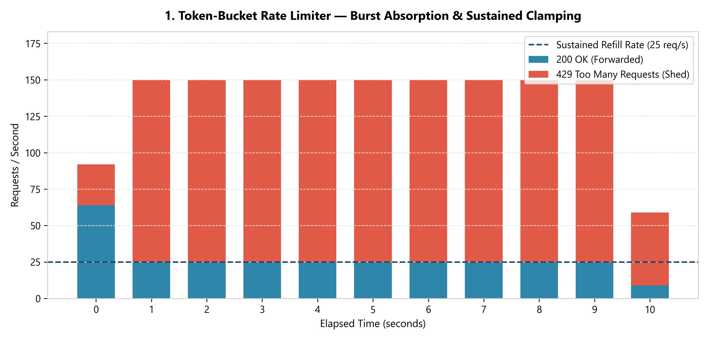
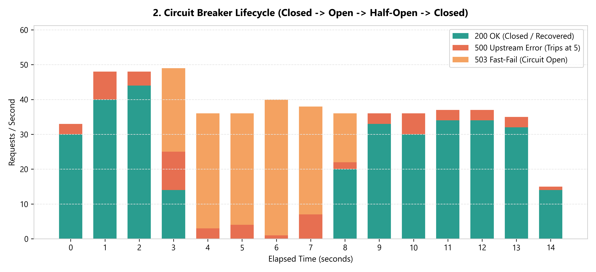
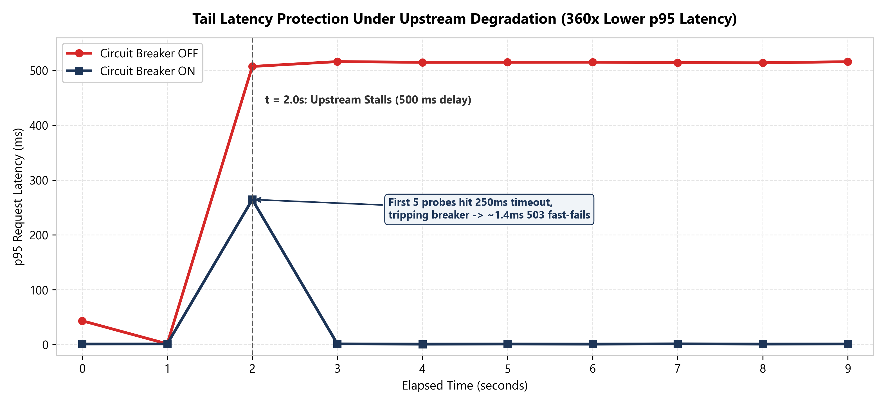
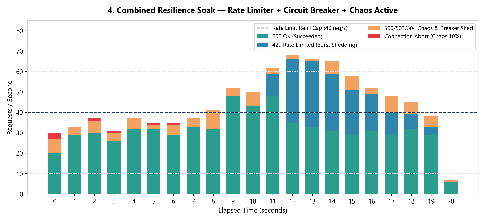

# ChaosProxy

A reverse proxy written in C# / ASP.NET Core (.NET 9) with built-in **token-bucket rate limiting**, a **circuit breaker**, **request timeouts**, and a **chaos engine** for injecting latency, errors and dropped connections.

It sustains **30.1k requests/second at 4.11 ms p99**, within **2.4% of Microsoft YARP's raw forwarding throughput** on the same hardware, while running every resilience check on every request.

---

## Features

| Component | What it does |
|---|---|
| **Rate limiter** | Per-client token bucket. Allows short bursts up to `Capacity`, then limits clients to `TokensPerSecond`. Excess requests get `429 Too Many Requests` with `X-RateLimit-*` headers. Idle buckets are removed after `BucketIdleTimeoutMinutes`. |
| **Chaos engine** | Injects faults with configurable probabilities: added latency (400–800 ms), `500` errors, and aborted connections. Used to test the other components under failure. |
| **Circuit breaker** | Opens after `FailureThreshold` consecutive upstream failures and returns `503` with `Retry-After` immediately instead of waiting on a failing upstream. After `BreakDurationSeconds` it lets one test request through (half-open); success closes the circuit, failure reopens it. |
| **Forwarder** | Forwards requests to the upstream using pooled keep-alive connections, with an optional per-request timeout (`RequestTimeoutMs`, returns `504`). |

### Request pipeline

```
Client ──► RateLimiter ──► ChaosEngine ──► CircuitBreaker ──► Forwarder ──► Upstream
             429             faults           503               504
```

The rate limiter runs first, so excess traffic is rejected before it costs anything downstream.

### Configuration

| Setting | Meaning |
|---|---|
| `RateLimiter.Capacity` | Maximum burst size (tokens) |
| `RateLimiter.TokensPerSecond` | Sustained refill rate |
| `RateLimiter.BucketIdleTimeoutMinutes` | When an unused client bucket is removed |
| `CircuitBreaker.Enabled` | Turn the breaker on or off |
| `CircuitBreaker.FailureThreshold` | Consecutive failures before opening |
| `CircuitBreaker.BreakDurationSeconds` | How long the circuit stays open before testing again |
| `HttpForwarder.RequestTimeoutMs` | Upstream timeout; `0` means no timeout |
| `ChaosEngine.Enabled` | Turn fault injection on or off |
| `ChaosEngine.LatencyProbability` / `FaultProbability` / `AbortProbability` | Chance of each fault per request (0–1) |

---

## Getting started

**Requirements:** .NET 9 SDK, and [k6](https://k6.io) for the benchmarks.

```bash
# 1. Start the mock upstream (http://localhost:5200)
dotnet run -c Release --project <path-to-MockUpstream>

# 2. Start the proxy
dotnet run -c Release --project <path-to-ChaosProxy>

# 3. Send a request through it
curl http://localhost:5107/ping
```

**MockUpstream endpoints** used by the tests:

| Endpoint | Behavior |
|---|---|
| `/ping` | Returns `200 OK` |
| `/fail` | Returns `500` |
| `/admin/slow?ms=500` | Makes every following response wait 500 ms |
| `/admin/heal` | Removes the delay |

---

## Benchmarks

**Environment:** AMD Ryzen 9 5900HX (8 cores / 16 threads), Windows 11, .NET 9.0.4. Load generated with Grafana k6 (50 virtual users, 15 s, HTTP/1.1 keep-alive). Component costs measured with BenchmarkDotNet in Release mode. k6, the proxy and the upstream all ran on the same machine; only one proxy ran at a time.

### 1. Throughput compared with other proxies

| Setup | Requests/s | Avg | p95 | p99 |
|---|---|---|---|---|
| Direct to upstream (no proxy) | 65,148 | 0.66 ms | 2.01 ms | 2.67 ms |
| Microsoft YARP 2.3.0 (no extra features) | 30,865 | 1.50 ms | 2.77 ms | 3.94 ms |
| **ChaosProxy (all checks running)** | **30,115** | **1.54 ms** | **2.81 ms** | **4.11 ms** |
| NGINX (official Windows build) | 15,026 | 3.26 ms | 6.00 ms | 10.24 ms |

- **ChaosProxy reaches 97.6% of YARP's throughput** while also doing rate limiting, circuit-breaker checks and chaos hooks on every request. Together these cost about 750 req/s, 40 µs of average latency, and 0.17 ms at p99.
- Throughput halves compared with calling the upstream directly. That's expected for an extra network hop on a machine where the load generator, proxy and upstream all share the CPU, and YARP shows the same drop.
- **About the NGINX result:** the official Windows build of NGINX uses an older `select()`-based event loop instead of Windows' I/O completion ports, which .NET uses. On Linux, NGINX performs much better. This comparison only reflects Windows.

### 2. Performance optimization

The first version of the proxy reached only **~4,200 req/s**. I profiled each pipeline stage separately with BenchmarkDotNet and removed allocations from the hot path:

| Stage | Before | After | Change | Allocated before → after |
|---|---|---|---|---|
| Rate limiter middleware | 247.77 ns | 217.94 ns | −12.0% | 46 B → 40 B* |
| Forwarder (request building) | 217.83 ns | 61.38 ns | −71.8% | 528 B → 264 B** |
| Circuit breaker (closed) | 29.52 ns | 13.95 ns | −52.7% | 0 B → 0 B |
| Chaos engine (disabled) | 13.70 ns | 3.16 ns | −76.9% | 0 B → 0 B |
| **Total per request** | **508.82 ns** | **296.43 ns** | **−41.7%** | **574 B → 304 B** |

What changed:
- Client buckets are keyed by `IPAddress` instead of a string IP.
- Header values are pre-built and cached (`StringValues`) instead of calling `ToString()` per request.
- `ValueTask<bool>` fast paths replace `async Task` state machines.
- The forwarder uses a direct `HttpForwarder` call (no lambda closure), cached `Uri` objects, and a static `HttpMethod.Get`.

\* 0 B for normal bucket sizes (≤ 1,024 tokens). The 40 B only appears because the benchmark used a capacity of 1,000,000, beyond the cached range.
\** The remaining 264 B is the `HttpRequestMessage` itself, which the .NET HTTP client requires.

**End-to-end result:**

| Version | Requests/s | Avg | p95 | p99 |
|---|---|---|---|---|
| Initial | ~4,200 | 11.80 ms | 21.40 ms | 29.80 ms |
| Optimized | 30,115 | 1.54 ms | 2.81 ms | 4.11 ms |

That's **~7.2× the throughput and ~7.3× lower p99 latency**, with 0% errors.

---

## Resilience tests

### Rate limiter: burst, then steady limit



**Setup:** capacity 50 tokens, refill 25 tokens/s, flooded at ~150 req/s for 10 s. Other components disabled.

- **Second 0:** ~65 requests succeed. That's the 50-token burst allowance plus one second of refill.
- **Seconds 1–9:** successful requests stay exactly on the 25 req/s refill line. The rest (~125 req/s) are rejected with `429` at the proxy and never reach the upstream.

### Circuit breaker: closed → open → half-open → closed



**Setup:** opens after 5 consecutive failures, stays open 4 s. ~40–50 req/s of traffic, with the upstream failing from t = 3 s until it recovers around t = 8 s.

- **0–2 s:** normal traffic succeeds. The occasional `/fail` request doesn't open the circuit, because any success resets the failure count.
- **3 s:** 5 consecutive `500`s open the circuit, and the rest of that second gets an immediate `503`.
- **4–7 s:** almost all traffic is rejected with `503` without touching the failing upstream. The small red slices are half-open test requests that fail and reopen the circuit.
- **8 s onward:** the upstream has recovered, a test request succeeds, the circuit closes, and normal traffic resumes.

### Tail latency when the upstream slows down



**Setup:** 40 req/s for 10 s (403 requests). At t = 2 s the upstream starts taking 500 ms per response, until t = 9.5 s.
- **Run A:** no circuit breaker, no timeout.
- **Run B:** circuit breaker (5 failures, 10 s) plus a 250 ms request timeout.

| Metric | A: unprotected | B: timeout + breaker |
|---|---|---|
| Responses | 403 × `200` | 83 × `200`, 5 × `504`, 315 × `503` |
| Average latency | 378.71 ms | 10.28 ms |
| p50 | 505.21 ms | 0.66 ms |
| p95 | 515.11 ms | **1.43 ms** (360× lower) |
| Max | 521.08 ms | 265.90 ms |
| Peak concurrent connections | 21 | 1 |

Without protection, every request waits the full 500 ms and connections pile up. With protection, the first 5 requests time out at 250 ms, which opens the circuit, and the remaining 315 requests fail in about a millisecond.

**The trade-off:** in run B, those 315 requests return an error instead of a slow success. Failing fast stops a slow upstream from tying up connections and threads, but clients need to handle `503` (for example, by retrying after `Retry-After`). The improvement comes from the timeout and the breaker together: the timeout turns slow responses into failures, and the breaker stops sending traffic after 5 of them.

### Everything at once: chaos soak



**Setup:** rate limit 60 tokens / 40 per second; breaker at 5 failures / 5 s; 250 ms timeout; chaos injecting 10% latency, 10% `500`s and 10% aborted connections. Traffic: 35 req/s, a surge to 70 req/s from 7 s to 13 s, then back to 35 req/s (927 requests in total).

| Result | Value |
|---|---|
| Succeeded | 657 (70.9%) |
| Rejected or failed (`429`, `500`, `503`, aborts) | 270 (29.1%) |
| p50 / p90 latency | 0.69 ms / 2.35 ms |
| p95 latency | 557.72 ms (caused by the injected 400–800 ms delays) |
| Peak concurrent connections | 5 |

- At 35 req/s, nothing is rate limited; only chaos faults appear.
- When the surge starts, the bucket's saved tokens briefly let traffic above 40 req/s through, then `429`s cap it at the limit.
- When traffic drops back, rate limiting stops by itself.
- No crashes, deadlocks or thread-pool starvation during the run.

---

## Limitations

- Benchmarks run on one Windows machine over loopback. Load generator, proxy and upstream share the CPU, so absolute numbers would differ on separate machines or on Linux.
- The circuit breaker counts **consecutive** failures. A failure-rate window would handle intermittent errors better.
- The circuit breaker covers a single upstream.
